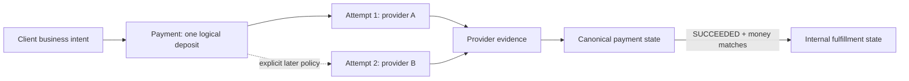
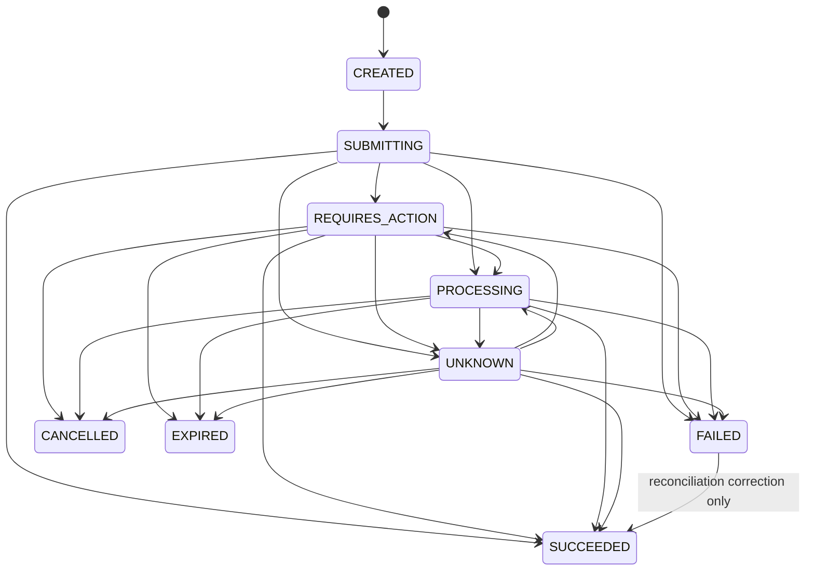
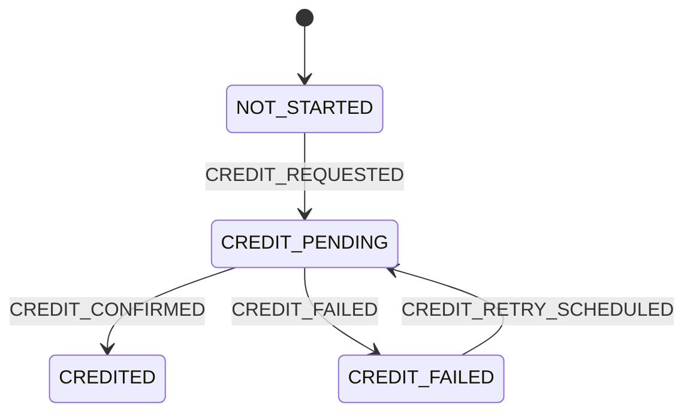

# Stage 2 architecture walkthrough

## Outcome

Stage 2 adds a plain TypeScript payment domain. It has no NestJS imports, database rows, HTTP exceptions, queues, or provider SDKs. It can therefore be tested as business policy in milliseconds and reused later by API handlers, workers, polling, and reconciliation.

The implementation is based on the supplied _CXM Payments Engineering Domain Knowledge Handbook_ and _deep-research-report_: payments evolve asynchronously; provider truth and internal fulfillment are separate; uncertain results must remain uncertain; and every state change must go through an explicit policy.

## The mental model



These are separate because they answer separate questions:

- Payment: what is the outcome of the customer's one business request?
- Attempt: what happened during this particular provider interaction?
- Fulfillment: after external money succeeded, did RailBridge deliver internal value?

Two attempts do not mean two client payments. Conversely, one successful provider attempt does not prove internal credit completed.

## Money

`Money` stores:

- `minorAmount`: a JavaScript safe integer;
- `currency`: a reviewed supported ISO currency code.

Examples:

| Construction                  | Meaning                                  |
| ----------------------------- | ---------------------------------------- |
| `Money.fromMinor(500, 'JPY')` | JPY 500 because JPY has 0 decimal places |
| `Money.fromMinor(500, 'USD')` | USD 5.00 because USD has 2               |
| `Money.fromMinor(500, 'KWD')` | KWD 0.500 because KWD has 3              |

The domain does not store `5.00` as floating point and does not infer every currency has two decimals. Equality checks both amount and currency. `Money` may represent zero or negative values for future accounting concepts, while `createPayment` separately enforces a strictly positive payment amount. This keeps the value object general and the deposit invariant explicit.

The initial registry is intentionally reviewed and finite: EUR, GBP, GHS, JPY, KES, KWD, NGN, and USD. Adding a currency is a code/configuration decision with tests, not an automatic uppercase string acceptance.

## Payment state machine



All other transitions are illegal. A transition to the current state is a no-op, which makes duplicated observations safe at the domain boundary.

### State meanings and operations policy

| State             | Meaning                                                     | Terminal?                         | Required entry evidence                                      | Likely customer wording | Operational attention policy                                    |
| ----------------- | ----------------------------------------------------------- | --------------------------------- | ------------------------------------------------------------ | ----------------------- | --------------------------------------------------------------- |
| `CREATED`         | RailBridge accepted a logical intent; no submission started | No                                | Payment construction                                         | Payment created         | Should move quickly or be identified as abandoned               |
| `SUBMITTING`      | A provider create call is beginning                         | No                                | `SUBMISSION_STARTED` system evidence                         | Starting payment        | A stuck submission requires investigation                       |
| `REQUIRES_ACTION` | Customer must redirect, authorize, or complete another step | No                                | Matching provider observation                                | Action required         | Expire according to provider/session policy                     |
| `PROCESSING`      | Provider accepted work but has no final result              | No                                | Matching provider observation                                | Payment processing      | Poll after provider-specific SLA                                |
| `UNKNOWN`         | RailBridge cannot determine the result safely               | No; high attention                | Unknown provider status or uncertain submitted-create result | Confirming your payment | Verify by status lookup/reconciliation; do not blindly resubmit |
| `SUCCEEDED`       | Provider confirms external money success                    | Yes                               | Matching provider evidence and provider reference            | Payment received        | Monitor fulfillment until credited or visibly failed            |
| `FAILED`          | Provider or a definitive immediate response proves failure  | Normally; reconciliation override | Matching provider evidence/reference or definitive response  | Payment failed          | No retry unless a new, explicit orchestration policy permits it |
| `CANCELLED`       | Provider proves cancellation                                | Yes                               | Matching provider evidence and provider reference            | Payment cancelled       | No local “stopped waiting” shortcut                             |
| `EXPIRED`         | Provider proves the payment/action window expired           | Yes                               | Matching provider evidence and provider reference            | Payment expired         | A new customer intent is normally required                      |

Exact timeout values are not domain constants because they vary by provider, payment method, and entity. Later operational configuration will decide when to poll or alert without changing what each state means.

## Why `UNKNOWN` exists in two places

An attempt can be unknown because a create request timed out after transmission. The logical payment must also expose uncertainty so RailBridge does not report failure or launch unsafe cascading.

They remain separate values because another attempt may eventually be allowed under an explicit safety policy, while operations still needs to know which original provider call is unresolved. Stage 2 deliberately does not implement automatic cascading.

An ordinary status-poll timeout is different: it says the observation failed, not that the payment changed. The state machine accepts `UNKNOWN_RESULT` error evidence only for the immediate result of `SUBMITTING`. A poll can move a state to `UNKNOWN` only if it returns actual provider evidence that RailBridge cannot normalize.

## The exceptional `FAILED -> SUCCEEDED` correction

Providers or early integrations can report failure and later expose success in a settlement/reconciliation record. Silently forbidding that correction would hide real money; broadly allowing it would let delayed weak events reopen terminal payments.

RailBridge therefore permits the correction only when:

1. the current state is `FAILED`;
2. the target is `SUCCEEDED`;
3. the source is `RECONCILIATION`;
4. the evidence is provider evidence normalized to `SUCCEEDED`;
5. a provider reference is present.

The correction still does not credit automatically. The independent fulfillment policy checks confirmed money first.

## Provider evidence and timestamps

Provider evidence preserves both worlds:

- provider and attempt identity;
- provider reference and event ID when supplied;
- raw provider status;
- normalized canonical observation;
- provider-reported money when supplied;
- provider occurrence time when supplied;
- RailBridge receipt time.

An undocumented raw status defaults to normalized `UNKNOWN`; it is never guessed into success, failure, or processing.

Four time concepts stay distinct:

| Time          | Meaning                                                            |
| ------------- | ------------------------------------------------------------------ |
| `requestedAt` | Client business intent was accepted                                |
| `occurredAt`  | Provider says the external fact happened; receipt time is fallback |
| `receivedAt`  | RailBridge received the response/event                             |
| `processedAt` | RailBridge evaluated and applied the transition                    |

This distinction later enables webhook latency, processing delay, status latency, incident timelines, and honest reconciliation.

## Payment attempts

`PaymentAttempt` owns provider-specific interaction identity:

- internal attempt ID;
- parent payment ID;
- provider name;
- sequence number;
- canonical attempt state;
- provider reference once known;
- latest provider-reported amount once known.

Evidence must name the same attempt and provider. Once set, an attempt's provider reference cannot change. These checks prevent a webhook or polling result for one provider call from mutating another attempt.

The sequence number records ordering but does not authorize attempt 2. Routing and cascading policy arrives in later stages.

## Fulfillment state machine



`CREDITED` cannot regress. Repeating the current state is a no-op.

Every fulfillment transition requires:

1. payment state `SUCCEEDED`;
2. provider-confirmed money exists;
3. confirmed minor amount equals requested minor amount;
4. confirmed currency equals requested currency;
5. a target-specific system evidence code.

This creates useful partial-failure truth:

```text
payment.state = SUCCEEDED
payment.fulfillmentState = CREDIT_FAILED
```

The external money is real, so the payment must not be changed to failed. A recovery worker can move fulfillment back to `CREDIT_PENDING` without repeating provider collection.

## Canonical errors versus recovery

`CanonicalError` describes what kind of failure occurred. `recoveryActionFor` gives the default workflow response. They are separate so adapters do not embed scheduling or orchestration decisions in error translation.

| Category         | Example                                  | Default recovery action  | Important non-example                             |
| ---------------- | ---------------------------------------- | ------------------------ | ------------------------------------------------- |
| `VALIDATION`     | malformed provider request               | `DO_NOT_RETRY`           | Provider create timeout                           |
| `AUTHENTICATION` | invalid/expired provider credential      | `DO_NOT_RETRY`           | Customer action required                          |
| `RATE_LIMIT`     | HTTP 429                                 | `RETRY_AFTER`            | Unknown result after POST                         |
| `TEMPORARY`      | known side-effect-free HTTP 503          | `RETRY_WITH_BACKOFF`     | A request that may already have created a payment |
| `PERMANENT`      | provider rejects unsupported currency    | `DO_NOT_RETRY`           | An undocumented status                            |
| `UNKNOWN_RESULT` | network timeout after submitted creation | `VERIFY_PROVIDER_STATUS` | A proven provider failure                         |

The action is a default classification boundary, not the Stage 10 retry scheduler. Later policy will add attempt counts, jitter, provider SLAs, and operation-specific idempotency guarantees.

## Transition return value

A transition does not write a database. It returns either:

```text
TRANSITIONED
  entity: new immutable current state
  transition: immutable history description

NO_OP
  entity: original entity
  transition: null
```

Stage 3 will load the entity, call this function, update the current row, and insert history in one database transaction. Keeping persistence outside prevents a domain rule from depending on NestJS, Drizzle, PostgreSQL, or a queue.

## Code tour

### Shared errors and validation

`src/domain/shared/domain-error.ts` defines errors in business language: invalid values, illegal transitions, evidence mismatch, and invariant violations. They are not HTTP exceptions. A later delivery adapter decides whether a domain error becomes HTTP 400, 409, an ignored duplicate, an operations alert, or a retry.

`validation.ts` centralizes non-blank and valid-date checks. It clones dates so callers cannot mutate the exact `Date` object stored by construction.

### Money

`currency.ts` is the reviewed currency metadata registry. `money.ts` is an immutable value object. `Money.equals` deliberately compares currency as well as units: USD 100 and NGN 100 are not equal value objects.

### Evidence

`evidence.ts` uses a discriminated union:

- `PROVIDER`: external observation;
- `SYSTEM`: an internal durable fact/command;
- `ERROR`: a classified operation failure.

The `kind` field lets TypeScript narrow which fields exist and makes unsupported evidence combinations explicit.

### Transition policy

`payment-state.ts` contains the complete normal transition adjacency table. `payment-transition-policy.ts` handles evidence requirements plus the one exceptional reconciliation correction. This separates “is this path legal?” from “does this evidence actually prove the target?”

`transition.ts` defines generic command, history, and result shapes. The state-machine functions remain specific because payment and fulfillment have different invariants.

### Aggregates

`payment.ts` constructs a positive-money logical payment and transitions its canonical state without mutation. Successful provider evidence can capture confirmed money.

`payment-attempt.ts` applies the same external state vocabulary to one provider interaction and enforces evidence identity/reference consistency.

`fulfillment.ts` controls internal value delivery independently and checks success plus exact money match before any credit work.

## Test strategy

The Stage 2 tests do not use `TestingModule` and never start NestJS.

- `money.spec.ts`: integer and currency metadata/equality rules.
- `payment-state-machine.spec.ts`: every allowed transition, every forbidden transition, duplicate no-op, terminal regression, late reconciliation success, unknown status, evidence, and timestamp semantics.
- `payment-attempt.spec.ts`: multiple attempts under one payment, provider reference capture, sequence validity, and evidence identity.
- `fulfillment-state-machine.spec.ts`: pre-success rejection, money matching, success/credit separation, retry, and terminal credit.
- `canonical-error.spec.ts`: exhaustive category-to-recovery behavior, especially no blind retry for unknown results.

The high test count comes from a table-generated cross-product. It turns the transition matrix into executable specification rather than hand-picking a few happy paths.

## Experiments for you to perform

Predict each result before running the test:

1. Add `PROCESSING` to the `SUCCEEDED` transition list and observe which regression test fails.
2. Change an unknown provider status to default to `FAILED`; explain the financial risk.
3. Remove currency comparison from `Money.equals`; run the fulfillment mismatch test.
4. Try `FAILED -> SUCCEEDED` from `WEBHOOK`, then from `RECONCILIATION`.
5. Attach provider-B evidence to a provider-A attempt.
6. Remove `reportedAmount` from success evidence and attempt to start credit.
7. Change a `CREDITED` payment back to `CREDIT_PENDING`.
8. Import a Nest decorator into `src/domain` and explain why that weakens the boundary even if tests still pass.

Revert each experiment before continuing.

## Acceptance answers

- `UNKNOWN` is safer than failure because a timeout describes RailBridge's observation, not provider truth.
- One payment can have several attempts because business intent and provider interaction have different identities.
- Error classification describes the failure; recovery policy decides an action under operation-specific safety constraints.
- A refund is a new financial operation with its own amount, lifecycle, reference, and idempotency—not a backwards payment state.
- Explicit transition tables plus terminal-state rejection prevent delayed weak evidence from undoing success.

## Stage 3 handoff

The next stage persists these values. PostgreSQL must atomically update current state and append transition history, preserve distinct requested/provider money, scope provider reference uniqueness, and prevent two concurrent workers from both committing incompatible transitions.
