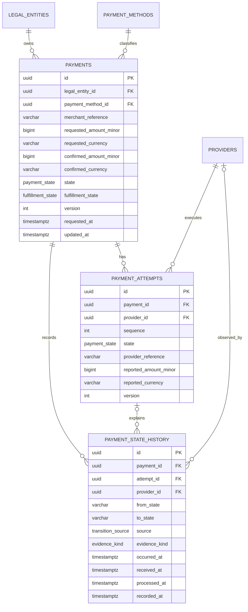

# Stage 3 architecture walkthrough

## Outcome

Stage 3 turns the Stage 2 model into durable, concurrency-safe PostgreSQL state. It adds six tables, versioned SQL migrations, explicit domain/row mappers, Nest-owned database lifecycle, repository ports, atomic state/history writes, schema-aware readiness, and real PostgreSQL integration tests.

No payment HTTP endpoint exists yet. Stage 4 will use this foundation for idempotent payment creation.

## Data model



## Why each table exists

| Table                   | Responsibility                                                                  |
| ----------------------- | ------------------------------------------------------------------------------- |
| `legal_entities`        | Stable identity for the regulated/business entity that owns a payment           |
| `payment_methods`       | Canonical method catalogue without embedding a free-form method on each payment |
| `providers`             | Provider plus environment identity and enable/disable lifecycle                 |
| `payments`              | Current logical payment and fulfillment truth                                   |
| `payment_attempts`      | Each provider interaction, reference, reported money, and version               |
| `payment_state_history` | Immutable explanation of every committed state change                           |

Inbox, outbox, idempotency, routing configuration, reconciliation cases, refunds, and withdrawals are intentionally absent until their stages.

## Identity and uniqueness decisions

- Internal UUIDs are never provider references.
- Merchant reference is unique per legal entity: `(legal_entity_id, merchant_reference)`.
- Attempt sequence is unique per payment: `(payment_id, sequence)`.
- Provider reference is unique per provider row: `(provider_id, provider_reference)`. Because a provider row includes environment, sandbox and production references do not collide.
- Provider code is unique per environment.
- PostgreSQL allows multiple `NULL` values in a unique index, so attempts may exist before a provider reference is known.

A unique constraint is stronger than `SELECT` followed by `INSERT`. Two transactions can both observe “not found”; only the database index can serialize the competing inserts and accept at most one.

## Money persistence

Requested and provider-confirmed/reported money use separate columns. This preserves disagreements instead of overwriting the client's request.

Amounts use PostgreSQL `bigint`, mapped through Drizzle's number mode. Check constraints cap requested amounts at JavaScript's maximum safe integer and require positive payment amounts. Currency checks allow only the Stage 2 registry. Nullable money pairs are all-or-nothing: amount and currency must both be null or both present.

The mapper reconstructs `Money` explicitly. Drizzle rows never enter domain functions directly.

## State constraints

PostgreSQL enums restrict current payment, attempt, fulfillment, transition-source, evidence-kind, and history-entity values. Check constraints additionally enforce:

- positive attempt sequence;
- non-negative optimistic versions;
- supported currencies;
- complete nullable money pairs;
- history `from_state <> to_state`;
- payment/attempt history uses payment states while fulfillment history uses fulfillment states;
- provider/system/error history contains the required evidence columns.

The domain remains the richer legal-transition authority. PostgreSQL protects representational invariants and concurrent commits; it does not duplicate every source/evidence rule from Stage 2.

## Immutable history

The migration adds a `BEFORE UPDATE OR DELETE` trigger that raises an exception for `payment_state_history`. All financial foreign keys use explicit `ON DELETE RESTRICT`. A referenced provider can be disabled but not removed.

Immutability means corrections are represented by new history, not editing old facts. Database administrators still retain exceptional operational power; application roles and audit controls will be hardened in Stage 18.

See the separate [provider evidence retention note](provider-evidence-retention.md).

## Optimistic transition algorithm

```mermaid
sequenceDiagram
    participant W1 as Worker 1
    participant W2 as Worker 2
    participant DB as PostgreSQL

    W1->>DB: Load PROCESSING, version 2
    W2->>DB: Load PROCESSING, version 2
    Note over W1: Domain accepts SUCCEEDED
    Note over W2: Domain accepts FAILED
    W1->>DB: UPDATE WHERE version = 2
    DB-->>W1: row returned; version becomes 3
    W1->>DB: INSERT immutable history
    W1->>DB: COMMIT
    W2->>DB: UPDATE WHERE version = 2
    DB-->>W2: zero rows
    Note over W2: OptimisticConcurrencyError; reload and re-evaluate
```

Representative SQL:

```sql
BEGIN;

UPDATE payments
SET state = $1,
    fulfillment_state = $2,
    confirmed_amount_minor = $3,
    confirmed_currency = $4,
    updated_at = $5,
    version = version + 1
WHERE id = $6
  AND version = $7
RETURNING *;

INSERT INTO payment_state_history (...)
VALUES (...);

COMMIT;
```

Zero updated rows means the snapshot is stale. The worker must reload and run the domain policy again because the newly committed state may make the old evidence a no-op, illegal regression, or still-valid transition.

If history insertion fails, PostgreSQL rolls back the state update. The integration suite proves this by deliberately violating the history evidence-shape constraint after an update.

## Concurrency alternatives

| Technique                 | Strength                                                  | Cost/risk                             | Stage 3 use                               |
| ------------------------- | --------------------------------------------------------- | ------------------------------------- | ----------------------------------------- |
| Optimistic version        | Detects stale writers without long application-held locks | Losers reload; conflict rate can rise | Chosen for payment/attempt state          |
| Conditional atomic update | Compare-and-swap in one SQL statement                     | Predicate/version must be correct     | Mechanism implementing optimistic version |
| `SELECT ... FOR UPDATE`   | Stable row while transaction decides                      | Blocking and deadlock risk            | Reserved for future multi-step use cases  |
| Unique constraint         | Safely arbitrates concurrent identity/reference creation  | Caller must interpret conflict        | Merchant, sequence, provider references   |
| Serializable isolation    | Protects broader read/write invariants                    | More aborts/retries and complexity    | Not needed for single-row transition      |

PostgreSQL's default `READ COMMITTED` level is enough for the chosen conditional update: a concurrent updater obtains the row lock first, and the waiting statement rechecks `version` after the winning commit.

## Nest and application boundaries

```text
PaymentsModule
├── PaymentLifecycleService              application orchestration
├── PAYMENT_REPOSITORY                   interface token
└── PostgresPaymentRepository            infrastructure adapter
    └── DATABASE_CLIENT

DatabaseModule
├── pg.Pool                              private lifecycle resource
├── DATABASE_CLIENT                      typed Drizzle client
└── DatabaseService                      readiness + graceful shutdown
```

`PaymentLifecycleService` loads a versioned record, invokes the Stage 2 domain transition, returns immediately for a no-op, and asks the repository to commit a real transition. It knows the repository interface, not Drizzle.

`PostgresPaymentRepository` translates between domain and rows, performs conditional updates, resolves provider evidence relationships, inserts history, and translates expected PostgreSQL constraint failures into persistence errors.

`DatabaseModule` is infrastructure shared by health and payment persistence. The pool is private; only the typed database token and lifecycle service are exported.

## Migration workflow

```bash
# Change src/database/schema.ts, then generate reviewed SQL
pnpm db:generate --name=describe_the_change

# Read every generated SQL statement before applying
pnpm db:migrate

# Optional local inspection UI
pnpm db:studio
```

Drizzle records applied migrations in `drizzle.__drizzle_migrations`. Do not edit a migration after it has been shared/applied; add a new migration instead. The Stage 3 immutability trigger is custom reviewed SQL because it is not represented by the Drizzle table schema DSL.

Application startup does not migrate. Deployment order is migration job first, then application rollout. This avoids multiple replicas racing to perform DDL.

## Readiness and shutdown

Stage 1's TCP probe could prove only that something accepted a socket. Stage 3 readiness now:

1. obtains a pooled PostgreSQL connection with a bounded connection timeout;
2. begins a short transaction;
3. applies transaction-local `statement_timeout`;
4. queries `to_regclass('public.payments')`;
5. reports ready only when the required table exists;
6. rolls back the read-only transaction and releases the connection.

Nest shutdown hooks call `pool.end()` through `DatabaseService`, allowing connections to close cleanly.

## Indexes and planned queries

| Index                                            | Planned query                                                 |
| ------------------------------------------------ | ------------------------------------------------------------- |
| `payments` primary key                           | canonical payment lookup                                      |
| `payments_entity_merchant_reference_uq`          | entity-scoped merchant request lookup/race arbitration        |
| `payments_customer_requested_at_idx`             | customer payment timeline                                     |
| `payments_entity_state_requested_at_idx`         | operations/poll/reconciliation scans by entity and state      |
| `payment_attempts_provider_reference_uq`         | webhook/status lookup and provider-reference race arbitration |
| `payment_attempts_payment_created_at_idx`        | ordered attempt history                                       |
| `payment_attempts_provider_state_updated_at_idx` | provider/state recovery scan                                  |
| `payment_state_history_payment_processed_at_idx` | payment incident timeline                                     |
| `payment_state_history_attempt_processed_at_idx` | attempt-specific investigation                                |

The integration test disables sequential scans inside one test transaction and verifies PostgreSQL selects the entity/state/time index for its intended query. Production plans must still be inspected with realistic row counts and `EXPLAIN (ANALYZE, BUFFERS)`.

## Real PostgreSQL tests

`pnpm test:integration` starts `postgres:18-alpine` with Testcontainers, migrates a clean database, and proves:

- migrations and schema readiness;
- money/state/timestamp mapping round-trip;
- entity-scoped merchant uniqueness;
- invalid money and currency check constraints;
- state plus history atomicity;
- rollback after a deliberately failing history insert;
- immutable history trigger;
- one winner for incompatible concurrent transitions;
- provider-reference uniqueness scoped by provider;
- provider deletion restriction and disable behavior;
- intended index selection.

This suite is separate from fast unit tests but is required in CI. It never substitutes SQLite or an in-memory fake for PostgreSQL behavior.

## Experiments for you to perform

1. Run `pnpm db:migrate` twice and inspect `drizzle.__drizzle_migrations` to see idempotent migration tracking.
2. Stop PostgreSQL: liveness stays up while readiness goes down.
3. Rename the `payments` table locally and observe schema-aware readiness fail even though `SELECT 1` would work.
4. Remove the version predicate in a temporary branch and rerun the concurrency test.
5. Throw between the conditional update and history insert; verify the transaction rolls back.
6. Start a transaction with `SELECT ... FOR UPDATE`, leave it open, and observe a competing update wait.
7. Lock two rows in opposite order from two sessions to produce `40P01`, then write down the stable lock-order rule.
8. Attempt to update or delete a history row and inspect SQLSTATE `P0001`.
9. Attempt to delete a referenced provider and inspect SQLSTATE `23001` from explicit `RESTRICT`.
10. Run `EXPLAIN (ANALYZE, BUFFERS)` after generating representative test rows; compare it with the small-table plan.

## Acceptance answers

- A unique constraint is stronger than find-then-insert because the database index arbitrates concurrent writers atomically.
- Optimistic concurrency fits short, low-contention single-aggregate transitions; row locks fit decisions that must hold a stable row across several dependent statements.
- The application use-case should own a multi-repository transaction boundary; this repository currently owns the atomic state/history persistence invariant for one aggregate.
- Raw provider payload stays outside canonical tables because it is unbounded, sensitive, provider-specific, and subject to different retention/access rules.
- A waiting transaction may block until lock release, hit a configured timeout, or be selected as a deadlock victim; callers need bounded retry/reload policy rather than infinite waiting.
